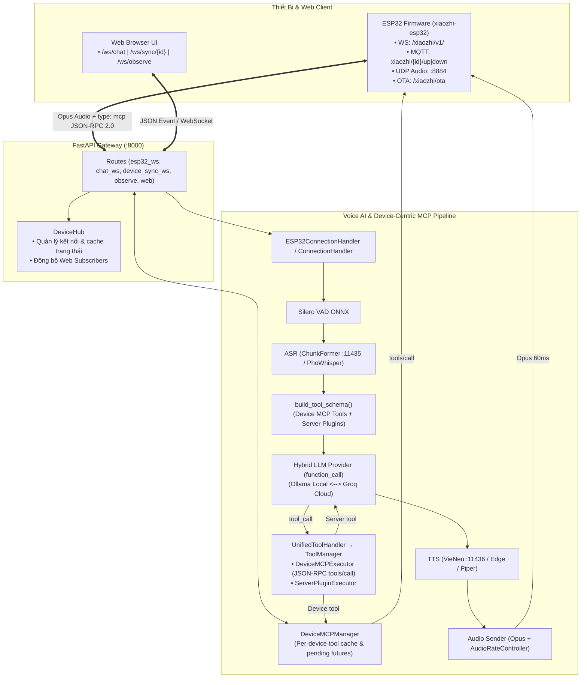

# Xiaozhi Server — Trợ Lý Giọng Nói AI Tiếng Việt (Device-Centric MCP)

> **Dự án**: Máy chủ điều phối giọng nói AI Tiếng Việt tương thích chuẩn **xiaozhi-esp32 / xiaozhi-esp32-server** (Phiên bản Xiaozhi CE v2.0.0).  
> **Nền tảng**: Python 3.11+ / FastAPI / PyTorch / ONNX Runtime / SQLAlchemy Async / ESP-IDF.  
> **Triết lý cốt lõi**: **Device-Centric MCP** — Thiết bị (`xiaozhi-esp32`) tự khai báo năng lực phần cứng qua giao thức **MCP (Model Context Protocol, JSON-RPC 2.0)**; Server đóng vai trò bộ điều phối thuần túy, cách ly danh mục tool theo từng thiết bị và để LLM gọi công cụ động thay vì tự đoán hay ép macro tool cứng.

---

## MỤC LỤC
1. [Tổng Quan & Triết Lý Device-Centric MCP](#1-tổng-quan--triết-lý-device-centric-mcp)
2. [Kiến Trúc Toàn Cảnh & Luồng Dữ Liệu](#2-kiến-trúc-toàn-cảnh--luồng-dữ-liệu)
3. [Cấu Trúc Mã Nguồn](#3-cấu-trúc-mã-nguồn)
4. [Giao Tiếp Thiết Bị & Vòng Đời MCP (JSON-RPC 2.0)](#4-giao-tiếp-thiết-bị--vòng-đời-mcp-json-rpc-20)
5. [Đường Ống Xử Lý Giọng Nói Thời Gian Thực (Voice AI Pipeline)](#5-đường-ống-xử-lý-giọng-nói-thời-gian-thực-voice-ai-pipeline)
6. [Bảng Tra Cứu Endpoints & Giao Thức](#6-bảng-tra-cứu-endpoints--giao-thức)
7. [Hướng Dẫn Cài Đặt (Windows & Ubuntu)](#7-hướng-dẫn-cài-đặt-windows--ubuntu)
8. [Vận Hành, Kiểm Thử & Giả Lập Thiết Bị](#8-vận-hành-kiểm-thử--giả-lập-thiết-bị)
9. [Nguyên Tắc Thiết Kế, Bảo Mật & Mở Rộng](#9-nguyên-tắc-thiết-kế-bảo-mật--mở-rộng)

---

## 1. TỔNG QUAN & TRIẾT LÝ DEVICE-CENTRIC MCP

**Xiaozhi Server** cung cấp tương tác giọng nói tiếng Việt hai chiều độ trễ thấp (Full-duplex Voice Interaction) cho thiết bị nhúng ESP32-S3 và trình duyệt Web:

* 🔌 **Device-Centric MCP thuần túy**: Khi thiết bị kết nối, Server thực hiện bắt tay chuẩn MCP (`initialize` → `notifications/initialized` → `tools/list` có phân trang `nextCursor`). Mỗi thiết bị sở hữu một danh sách tool độc lập trong `DeviceMCPManager` (theo `device_id`), không rò rỉ vào registry toàn cục và không bị ép vào các macro tool giả định phần cứng cố định.
* 🎙️ **Đàm thoại thời gian thực (Streaming Pipeline)**: Chuỗi xử lý `Silero VAD → ChunkFormer/PhoWhisper ASR → Hybrid LLM (Native Function Calling) → Sentence Splitter → VieNeu TTS → Opus 60ms`, hỗ trợ ngắt lời tức thì (Barge-in / Audio Abort).
* 🧠 **Native Function Calling (`Intent: function_call`)**: Toàn bộ tool MCP mà thiết bị tự khai báo được hợp nhất cùng các server plugin (thời tiết, lịch biểu, tìm kiếm web, phát nhạc) và truyền trực tiếp cho LLM tự quyết định gọi `tools/call`.
* 📅 **Lịch biểu, Nhắc việc & Giải trí**: Quản lý lịch SQLite, nhắc hẹn chủ động qua loa ESP32, tìm kiếm và stream nhạc từ YouTube.
* 🖥️ **Web Dashboard & Telemetry**: Đồng bộ trạng thái cảm biến/thiết bị hai chiều qua `/ws/sync/{device_id}` và giám sát luồng sự kiện qua `/ws/observe`.

---

## 2. KIẾN TRÚC TOÀN CẢNH & LUỒNG DỮ LIỆU



### Luồng điều phối công cụ (Tool Orchestration Flow):
1. **Discovery khi kết nối**: `esp32_ws.py` gắn transport vào `DeviceMCPManager` và chạy `discover_tools(device_id)` (`initialize` → `notifications/initialized` → `tools/list`).
2. **Hợp nhất schema động**: Tại mỗi lượt hội thoại, `build_tool_schema(query, device_id=...)` lấy **toàn bộ MCP tool** của đúng `device_id` đó kết hợp với các server plugin phù hợp, truyền cho LLM.
3. **Thực thi chuẩn JSON-RPC 2.0**: Khi LLM chọn một tool của thiết bị, `UnifiedToolHandler` → `ToolManager` → `DeviceMCPExecutor` gọi `DeviceMCPManager.call_tool(device_id, tool_name, arguments)` với `req_id` duy nhất và chờ `Future` phản hồi `result` / `error`, sau đó trả `Action.REQLLM` để LLM diễn đạt câu trả lời tự nhiên.

---

## 3. CẤU TRÚC MÃ NGUỒN

```text
D:\Xiaozhi_server\
├── app/
│   ├── core/
│   │   ├── api/ota_handler.py              # Cấp cấu hình WS/MQTT & audio params qua /xiaozhi/ota
│   │   ├── protocols/                      # WebSocketTransport, MqttTransport, binary Opus framing (v1/v2/v3)
│   │   ├── providers/
│   │   │   ├── asr/                        # ChunkFormer, PhoWhisper
│   │   │   ├── intent/                     # function_call.py (mặc định), intent_llm.py, nointent.py
│   │   │   ├── llm/                        # hybrid_provider.py, ollama.py, openai_compatible.py
│   │   │   ├── memory/                     # local.py, mem_local_short.py
│   │   │   ├── tools/
│   │   │   │   ├── device_mcp_manager.py   # Quản lý handshake & tool MCP cách ly theo device_id
│   │   │   │   ├── executors.py            # ServerPluginExecutor, ServerMCPExecutor, DeviceMCPExecutor
│   │   │   │   ├── tool_manager.py         # Điều phối executor theo scope thiết bị / ToolType
│   │   │   │   ├── registry.py             # Tool schema server, select_server_tool_names() & execute_tool()
│   │   │   │   ├── unified/                # Action, ActionResponse, FunctionRegistry, UnifiedToolHandler
│   │   │   │   ├── plugins.py              # Server plugins (weather, time, search, music, sensor)
│   │   │   │   ├── calendar.py             # Công cụ quản lý lịch trình
│   │   │   │   └── builtin.py / scenes.py / parallel_search.py
│   │   │   ├── tts/                        # VieNeu, Edge, Piper
│   │   │   └── vad/                        # Silero VAD ONNX, Energy VAD
│   │   ├── routing/
│   │   │   ├── fast_track.py               # Phản hồi nhanh cho chào hỏi, nhạc, toán, ngày giờ, tra cứu lịch
│   │   │   ├── greeting.py                 # Sinh câu chào theo khung giờ
│   │   │   └── intent_filter.py            # Lọc pure chat & hợp nhất Device MCP + Server tools cho LLM
│   │   ├── utils/                          # Opus codec, AudioReorderer, text_utils, TTSCache
│   │   ├── connection.py                   # ConnectionHandler: vòng đời hội thoại & tool loop
│   │   ├── esp32_connection.py             # Kế thừa ConnectionHandler: Audio Sender Loop cho ESP32
│   │   ├── device_hub.py                   # Quản lý trạng thái kết nối & sync đa kênh
│   │   ├── mqtt_server.py                  # MQTT broker/bridge (port 1883)
│   │   ├── udp_server.py                   # UDP audio server (port 8884)
│   │   ├── reminder_engine.py              # Quét và phát nhắc hẹn lịch biểu
│   │   └── runtime.py                      # Shared AI providers lifecycle
│   ├── repositories/                       # SQLAlchemy async repositories (calendar, chat)
│   ├── routes/                             # esp32_ws.py, chat_ws.py, device_sync_ws.py, web_ui.py, api.py
│   ├── config.py / models.py / database.py / main.py / music.py
├── asr/                                    # Microservice ASR độc lập (port 11435)
├── vieneu-server/                          # Microservice VieNeu TTS (port 11436)
├── scripts/                                # mock_esp32.py và công cụ đo độ trễ
├── tests/                                  # Bộ kiểm thử pytest (bao gồm test_device_mcp.py)
├── config.yaml                             # Cấu hình hệ thống
├── START_FAST.bat                          # Khởi chạy nhanh trên Windows (bật Ollama + KV cache q8_0)
└── run.py                                  # Trình khởi chạy song song các dịch vụ AI & FastAPI
```

---

## 4. GIAO TIẾP THIẾT BỊ & VÒNG ĐỜI MCP (JSON-RPC 2.0)

### 4.1. Định danh & OTA
* Thiết bị gửi `Device-Id` (MAC chuẩn hóa dạng `AA:BB:CC:DD:EE:FF`) qua HTTP Header khi gọi `GET`/`POST /xiaozhi/ota` hoặc kết nối `/xiaozhi/v1/`.
* Server trả cấu hình WebSocket URL và `audio_params` (`opus`, `16000 Hz`, `mono`, `60ms`).

### 4.2. Kênh WebSocket `/xiaozhi/v1/` & Binary Framing
* Handshake `{"type": "hello", "version": 1, "features": {"mcp": true}, "transport": "websocket"}`.
* Hỗ trợ 3 phiên bản đóng gói frame Opus: **v1** (raw Opus), **v2** (header 16 bytes có timestamp AEC), **v3** (header 4 bytes).

### 4.3. Vòng đời MCP chuẩn JSON-RPC 2.0
Mọi bản tin MCP được bọc trong `{"type": "mcp", "payload": { ... }}`:
1. **Server → Thiết bị (`initialize`)**: Thương lượng `protocolVersion: "2024-11-05"`.
2. **Server → Thiết bị (`notifications/initialized`)**: Xác nhận hoàn tất khởi tạo phiên MCP.
3. **Server → Thiết bị (`tools/list`)**: Lấy danh sách toàn bộ tool mà firmware hiện tại hỗ trợ (tự động lặp theo `nextCursor` nếu có nhiều trang).
4. **Server → Thiết bị (`tools/call`)**: Khi LLM yêu cầu thực thi một tool của thiết bị, Server chuyển tiếp `{"jsonrpc": "2.0", "id": req_id, "method": "tools/call", "params": {"name": "...", "arguments": {...}}}` và trả kết quả về cho LLM.

> Thiết bị hỗ trợ thêm `notifications/sensor_state` hoặc `{"type": "sensor", ...}` để đẩy telemetry về `DeviceHub` và đồng bộ lên Web UI qua `/ws/sync/{device_id}`.

---

## 5. ĐƯỜNG ỐNG XỬ LÝ GIỌNG NÓI THỜI GIAN THỰC (VOICE AI PIPELINE)

1. **VAD**: `Silero VAD ONNX` chạy trên PCM 16 kHz, tối ưu ngưỡng ngắt câu cho tiếng Việt (`silence_duration_ms: 600`).
2. **ASR**: `ChunkFormer CTC Large Vietnamese` (`:11435`) hoặc `PhoWhisper`.
3. **Fast-Track & Native Function Calling**:
   - `fast_track.py` hỗ trợ xử lý nhanh các tác vụ thuần server/phi phần cứng khi `pipeline.fast_track_enabled: true` (chào hỏi, phát nhạc theo tên bài, phép tính đơn giản, ngày/giờ, bơm ngữ cảnh tra cứu lịch). Mọi yêu cầu điều khiển thiết bị đều đi qua LLM.
   - `intent_filter.py` tự động bỏ qua tool schema với câu chat thuần (`looks_like_pure_chat`) và dùng `select_server_tool_names` hợp nhất cùng MCP tools của thiết bị.
   - `selected_module.Intent: function_call` trong `config.yaml` để LLM chính (`Hybrid LLM`: Ollama Local ưu tiên, Groq Cloud dự phòng cho web search/tin tức/suy luận kèm lọc tool và chặn câu phủ định) tự quyết định gọi tool MCP động của thiết bị hoặc server plugin.
4. **Streaming TTS & Barge-in**: Tách câu trực tuyến qua `extract_sentences()`, tổng hợp song song qua `VieNeu TTS` (`:11436`), sắp xếp thứ tự qua `AudioReorderer`, và hủy ngay lập tức khi nhận `abort` / barge-in.

---

## 6. BẢNG TRA CỨU ENDPOINTS & GIAO THỨC

| Nhóm | Endpoint / Cổng | Giao thức | Chức năng |
| :--- | :--- | :--- | :--- |
| **Firmware** | `/xiaozhi/v1/` | WebSocket | Kênh chính của ESP32 (Opus audio, JSON-RPC MCP, telemetry) |
| **Firmware** | `/xiaozhi/ota` | HTTP GET/POST | Cấp endpoint kết nối và tham số âm thanh |
| **Firmware** | Port `1883` / `8884` | MQTT / UDP | Giao thức thay thế (`xiaozhi/{id}/up\|down`) và UDP audio mã hóa AES-CTR |
| **Web Client** | `/` hoặc `/chat` | HTTP GET | Giao diện Web Dashboard (`templates/index.html`) |
| **Web Client** | `/ws/chat` | WebSocket | Web Chat thời gian thực |
| **Web Client** | `/ws/sync/{device_id}` | WebSocket | Đồng bộ trạng thái thiết bị/cảm biến 2 chiều |
| **Web Client** | `/ws/observe` | WebSocket | Luồng sự kiện giám sát hệ thống |
| **REST API** | `/api/sessions`, `/api/calendar/*`, `/health` | HTTP | Quản lý phiên, lịch biểu và kiểm tra trạng thái dịch vụ |

---

## 7. HƯỚNG DẪN CÀI ĐẶT (WINDOWS & UBUNTU)

### 7.1. Yêu cầu hệ thống
* Python **3.11**, **FFmpeg** (trong `PATH`), **Ollama** (`http://localhost:11434`).

### 7.2. Cài đặt nhanh
**Windows (PowerShell):**
```powershell
py -3.11 -m venv venv
.\venv\Scripts\Activate.ps1
pip install torch torchaudio --index-url https://download.pytorch.org/whl/cpu   # hoặc cu124 cho NVIDIA GPU
pip install -r requirements-win.txt
```

**Ubuntu / Linux:**
```bash
sudo apt update && sudo apt install -y python3.11 python3.11-venv python3-pip ffmpeg libopus0 libopus-dev portaudio19-dev build-essential
python3.11 -m venv venv
source venv/bin/activate
pip install torch torchaudio --index-url https://download.pytorch.org/whl/cpu   # hoặc cu124 cho NVIDIA GPU
pip install -r requirements-ubuntu.txt
```

Tạo `.env` ở thư mục gốc (tùy chọn cho các tool cloud):
```env
GROQ_API_KEY=gsk_your_groq_api_key_here
TAVILY_API_KEY=your_tavily_search_key
```

---

## 8. VẬN HÀNH, KIỂM THỬ & GIẢ LẬP THIẾT BỊ

### 8.1. Khởi chạy
```bash
python run.py
# Hoặc trên Windows:
START_FAST.bat
```
`run.py` khởi chạy **song song** Ollama, microservice ASR (`:11435`) và VieNeu TTS (`:11436`), sau đó khởi động FastAPI server (`:8000`) — nơi `lifespan` thực hiện warmup LLM/TTS/ASR một lần duy nhất và mở Cloudflare Tunnel ở chế độ nền. Khi thoát, `run.py` và `app/main.py` tự động giải phóng VRAM Ollama.

### 8.2. Kiểm thử tự động
```powershell
.\venv\Scripts\python.exe -m pytest tests/test_device_mcp.py -v
```
Các file test chính trong `tests/`:
* `tests/test_device_mcp.py`: Kiểm tra bắt tay MCP (`initialize` → `notifications/initialized` → `tools/list` phân trang), cách ly tool theo `device_id`, `build_tool_schema` và thực thi `tools/call`.
* `tests/test_binary_protocol.py`, `tests/test_device_sync.py`, `tests/test_connection_registry.py`, `tests/test_security_endpoints.py`.

### 8.3. Giả lập thiết bị ESP32
```powershell
python scripts/mock_esp32.py
```

---

## 9. NGUYÊN TẮC THIẾT KẾ, BẢO MẬT & MỞ RỘNG

* **Tách bạch VRAM**: VieNeu TTS chạy CPU ONNX int8 để nhường toàn bộ VRAM GPU cho LLM cục bộ.
* **Bảo mật khi public**: Bật `server.auth.enabled: true` trong `config.yaml` và cấu hình token thiết bị trong `data/devices.json` trước khi mở qua tunnel; lỗi trả về client được làm sạch qua `app/core/error_sanitizer.py`.
* **Mở rộng đa worker**: Trạng thái `DeviceHub` và `DeviceMCPManager` hiện lưu trong bộ nhớ tiến trình đơn; khi scale nhiều worker cần bổ sung Redis Pub/Sub để định tuyến session.
