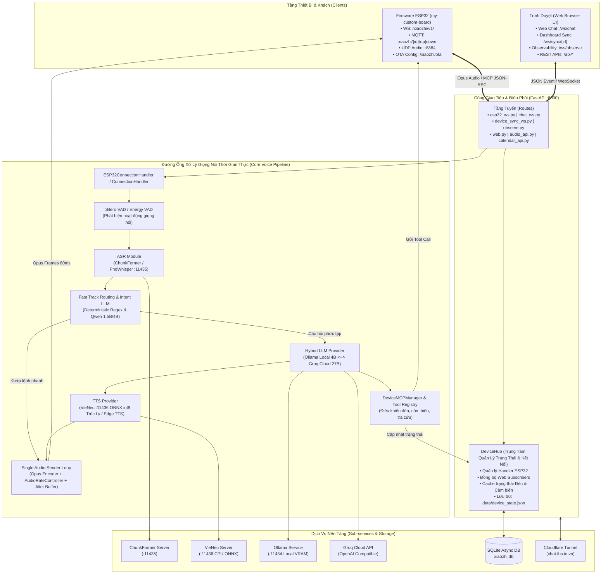

# Xiaozhi Server — PBL3 Đèn Học Thông Minh AI Tiếng Việt

> **Dự án**: Hệ thống máy chủ AI điều khiển Đèn học thông minh bằng giọng nói Tiếng Việt (Phiên bản Xiaozhi CE v2.0.0).  
> **Nền tảng**: Python 3.11+ / FastAPI / PyTorch / ONNX Runtime / SQLAlchemy Async / ESP-IDF.  
> **Mục tiêu**: Máy chủ trung tâm đóng vai trò là "Bộ não AI & IoT Gateway" tiếp nhận luồng thoại thời gian thực từ vi điều khiển ESP32, thực hiện chuỗi xử lý AI đa tầng (VAD → ASR → Fast-Track / Intent → Hybrid LLM → TTS), điều khiển phần cứng qua giao thức MCP (Model Context Protocol) và đồng bộ trạng thái hai chiều với Web Dashboard.

---

## MỤC LỤC
1. [Tổng Quan Dự Án & Tính Năng Cốt Lõi](#1-tổng-quan-dự-án--tính-năng-cốt-lõi)
2. [Kiến Trúc Toàn Cảnh & Sơ Đồ Luồng Dữ Liệu](#2-kiến-trúc-toàn-cảnh--sơ-đồ-luồng-dữ-liệu)
3. [Cấu Trúc Phân Lớp Mã Nguồn Chi Tiết](#3-cấu-trúc-phân-lớp-mã-nguồn-chi-tiết)
4. [Hợp Đồng Giao Tiếp Thiết Bị & Giao Thức Mạng](#4-hợp-đồng-giao-tiếp-thiết-bị--giao-thức-mạng)
5. [Đường Ống Xử Lý Giọng Nói Thời Gian Thực (Voice AI Pipeline)](#5-đường-ống-xử-lý-giọng-nói-thời-gian-thực-voice-ai-pipeline)
6. [Bảng Tra Cứu Endpoints & Giao Thức Truyền Thông](#6-bảng-tra-cứu-endpoints--giao-thức-truyền-thông)
7. [Hướng Dẫn Cài Đặt Chi Tiết (Windows & Ubuntu)](#7-hướng-dẫn-cài-đặt-chi-tiết-windows--ubuntu)
8. [Vận Hành, Kiểm Thử & Giả Lập Thiết Bị](#8-vận-hành-kiểm-thử--giả-lập-thiết-bị)
9. [Nguyên Tắc Thiết Kế, Bảo Mật & Hướng Mở Rộng](#9-nguyên-tắc-thiết-kế-bảo-mật--hướng-mở-rộng)

---

## 1. TỔNG QUAN DỰ ÁN & TÍNH NĂNG CỐT LÕI

Hệ thống **Xiaozhi Server** được xây dựng nhằm giải quyết bài toán tương tác giọng nói tiếng Việt hai chiều có độ trễ cực thấp (Full-duplex Voice Interaction) trên các thiết bị nhúng IoT giới hạn tài nguyên tính toán (như ESP32-S3), kết hợp tính năng nhà thông minh chuyên sâu cho đèn học:

* 🎙️ **Đàm thoại tự nhiên thời gian thực**: Trò chuyện hai chiều mượt mà, phản hồi siêu tốc (< 1s), hỗ trợ cơ chế ngắt lời tức thì (Barge-in / Audio Abort) khi người dùng cướp lời bot.
* 💡 **Điều khiển đèn thông minh qua MCP**: Bật/tắt, tùy chỉnh độ sáng mượt mà (0-100%), đổi nhiệt độ màu ánh sáng CCT (Vàng ấm 3000K → Trung tính 4500K → Trắng sáng 6000K), kích hoạt các kịch bản chiếu sáng (Đọc sách, Học bài, Nghỉ ngơi).
* 🌡️ **Giám sát môi trường đa thông số**: Thu thập dữ liệu cảm biến từ phần cứng (Nhiệt độ, Độ ẩm, Bụi mịn PM2.5, Cường độ ánh sáng Lux, Radar phát hiện người ngồi học mmWave).
* ⚡ **Định tuyến thông minh (Smart Routing & Fast Track)**: Xử lý tức thì các câu lệnh phổ biến (hỏi giờ, hỏi ngày, thời tiết cơ bản, phép tính số học, lệnh đèn) trong < 50ms mà không cần gọi LLM; tự động điều phối giữa mô hình cục bộ Ollama (Qwen 4B) và mô hình đám mây Groq API (Qwen 27B).
* 📅 **Lịch biểu & Nhắc việc thời gian thực**: Tích hợp công cụ quản lý lịch, tự động quét và phát âm thanh thông báo nhắc việc qua loa đèn theo thời gian thực.
* 🎵 **Phát nhạc & Giải trí**: Tìm kiếm và stream âm thanh nhạc từ YouTube trực tiếp xuống loa ESP32 hoặc trình duyệt web.
* 🖥️ **Web Dashboard 2 chiều**: Giao diện trực quan hiển thị mô hình đèn 3D, thanh trượt đồng bộ thời gian thực, bảng theo dõi cảm biến và khung chat hội thoại.

---

## 2. KIẾN TRÚC TOÀN CẢNH & SƠ ĐỒ LUỒNG DỮ LIỆU

Hệ thống hoạt động theo mô hình Gateway trung tâm kết nối giữa phần cứng nhúng, giao diện người dùng và các dịch vụ AI chuyên biệt:



### Chi tiết các luồng dữ liệu cốt lõi:
1. **Luồng âm thanh đàm thoại (Audio Pipeline)**:
   - *Uplink (ESP32 → Server)*: Mic I2S thu âm 16 kHz → Opus encoder đóng khung 60ms → Gửi qua WebSocket `/xiaozhi/v1/` → Server giải mã Opus thành PCM → Silero VAD bắt khoảng nói/ngắt câu → ASR chuyển thành văn bản → Fast-Track / LLM sinh câu trả lời.
   - *Downlink (Server → ESP32)*: Ngay khi LLM xuất hiện câu hoàn chỉnh đầu tiên → Sentence Splitter tách câu → VieNeu TTS tổng hợp thành WAV → Chuyển đổi sang PCM 16 kHz → Mã hóa Opus → `AudioRateController` gửi từng khung 60ms xuống loa ESP32 để phát.
2. **Luồng điều khiển thiết bị (MCP Hardware Control)**:
   - Người dùng ra lệnh bằng giọng nói (ví dụ: *"Bật đèn mức 80%"*) hoặc kéo thanh trượt trên Web Dashboard.
   - Server phân giải thành tool call `Lamp.SetBrightness(value=80)`.
   - `DeviceMCPManager` gửi bản tin JSON-RPC 2.0 xuống ESP32.
   - ESP32 thực thi phần cứng (thay đổi PWM LED) và phản hồi `result: success`.
   - `DeviceHub` nhận kết quả, lưu vào `data/device_state.json` và phát sự kiện `lamp_sync` tức thì tới tất cả các trình duyệt Web đang mở.

---

## 3. CẤU TRÚC PHÂN LỚP MÃ NGUỒN CHI TIẾT

```text
D:\Xiaozhi_server\
├── app/                                # Mã nguồn máy chủ trung tâm FastAPI
│   ├── core/                           # Nhân kiến trúc, pipeline thoại và providers
│   │   ├── api/                        # Handlers API cấp thấp
│   │   │   └── ota_handler.py          # Xử lý /xiaozhi/ota: cấp endpoint WS & audio params
│   │   ├── protocols/                  # Trừu tượng hóa giao thức vận chuyển
│   │   │   ├── base.py                 # WebSocketTransport, MqttTransport (timeout 10s)
│   │   │   └── binary.py               # Đóng/mở gói Opus framing (v1 raw, v2 timestamp, v3 header)
│   │   ├── providers/                  # Factory & Drivers tích hợp AI (Provider Pattern)
│   │   │   ├── asr/                    # Drivers ASR (chunkformer.py, phowhisper.py)
│   │   │   ├── intent/                 # Phân loại ý định (intent_llm.py, function_call.py, nointent.py)
│   │   │   ├── llm/                    # Trình điều phối LLM (hybrid_provider.py, ollama.py, openai_compatible.py)
│   │   │   ├── memory/                 # Bộ nhớ ngữ cảnh (local.py, mem_local_short.py)
│   │   │   ├── tools/                  # Kho công cụ nghiệp vụ (builtin.py, calendar.py, music.py, registry.py, scenes.py)
│   │   │   │   ├── unified/            # Chuẩn hóa Action, ActionResponse, UnifiedToolHandler
│   │   │   │   └── device_mcp_manager.py # Quản lý tool MCP động theo từng thiết bị phần cứng
│   │   │   ├── tts/                    # Drivers TTS (vieneu.py, edge.py, piper.py)
│   │   │   └── vad/                    # Phát hiện tiếng nói (silero.py ONNX, energy.py)
│   │   ├── routing/                    # Bộ định tuyến thông minh
│   │   │   ├── fast_track.py           # Định tuyến regex xác định (< 50ms) cho giờ, ngày, toán, đèn
│   │   │   ├── greeting.py             # Xử lý câu chào hỏi khởi động
│   │   │   └── intent_filter.py        # Lọc danh mục tool động theo câu hỏi
│   │   ├── utils/                      # Xử lý kỹ thuật phụ trợ
│   │   │   ├── audio.py                # Chuyển đổi định dạng âm thanh (ffmpeg / wav)
│   │   │   ├── audio_rate_controller.py # Điều tiết tốc độ gửi khung Opus tránh tràn buffer ESP32
│   │   │   ├── audio_reorderer.py      # Sắp xếp thứ tự gói âm thanh
│   │   │   ├── dialogue.py             # Cấu trúc dữ liệu hội thoại
│   │   │   ├── opus_codec.py           # Wrapper mã hóa / giải mã libopus
│   │   │   ├── sentence_splitter.py    # Tách câu trực tuyến cho streaming TTS
│   │   │   ├── text_cleaner.py         # Làm sạch ký tự lạ, lọc chữ tiếng Trung, rút gọn text
│   │   │   ├── tts_cache.py            # Bộ nhớ đệm âm thanh TTS cho câu nói cố định
│   │   │   └── udp_crypto.py           # Mã hóa AES-CTR cho gói tin UDP
│   │   ├── automation.py               # Tự động hóa đèn thông minh & chiếu sáng thích ứng
│   │   ├── cleanup_engine.py           # Động cơ định kỳ dọn dẹp cache nhạc và dữ liệu quá hạn
│   │   ├── config_validator.py         # Kiểm tra tính hợp lệ của file cấu hình khi khởi động
│   │   ├── connection.py               # ConnectionHandler: Vòng đời đàm thoại, streaming, ngắt lời
│   │   ├── connection_registry.py      # Cầu nối định tuyến thiết bị active tới DeviceHub
│   │   ├── device_auth.py              # Xác thực Token thiết bị phần cứng qua data/devices.json
│   │   ├── device_hub.py               # DeviceHub: Quản lý kết nối, state cache, sync đa kênh
│   │   ├── error_sanitizer.py          # Làm sạch thông báo lỗi, chống lộ lọt thông tin nhạy cảm
│   │   ├── esp32_connection.py         # Kế thừa ConnectionHandler: Single Audio Sender Loop cho ESP32
│   │   ├── logger.py                   # Quản lý Loguru xoay vòng, lọc theo session
│   │   ├── mqtt_server.py              # Cầu nối MQTT Client/Broker thay thế cho WebSocket
│   │   ├── reminder_engine.py          # Động cơ quét và thông báo nhắc hẹn lịch trình
│   │   ├── runtime.py                  # Singleton quản lý vòng đời shared AI providers
│   │   ├── scheduler.py                # Lập lịch tác vụ nền (APScheduler integration)
│   │   ├── signal_handler.py           # Bắt tín hiệu tắt hệ thống (SIGINT/SIGTERM) an toàn
│   │   ├── tunnel_service.py           # Tự động tạo và duy trì Cloudflare Named Tunnel
│   │   ├── udp_server.py               # Máy chủ UDP nhận âm thanh độ trễ cực thấp
│   │   └── warmup.py                   # Pre-warm model khi khởi động máy chủ
│   ├── repositories/                   # Tầng truy cập dữ liệu (Repository Pattern)
│   │   ├── calendar.py                 # CRUD CalendarEvent, CalendarReminder
│   │   └── chat.py                     # CRUD Device, Session, Message, thống kê
│   ├── routes/                         # Tầng API & WebSocket Endpoints
│   │   ├── audio_api.py                # REST API phát / tải âm thanh tin nhắn
│   │   ├── calendar_api.py             # REST API quản trị sự kiện lịch biểu
│   │   ├── chat_ws.py                  # WebSocket chat dành cho giao diện web (/ws/chat)
│   │   ├── device_sync_ws.py           # WebSocket đồng bộ trạng thái tức thời (/ws/sync/{device_id})
│   │   ├── esp32_ws.py                 # WebSocket chính tiếp nhận ESP32 (/xiaozhi/v1/)
│   │   ├── observe.py                  # WebSocket giám sát sự kiện toàn hệ thống (/ws/observe)
│   │   └── web.py                      # Tuyến phục vụ giao diện HTML Dashboard và file log
│   ├── schemas/                        # Định nghĩa cấu trúc dữ liệu Pydantic
│   │   └── websocket.py                # Bản tin HelloMessage, TextMessage
│   ├── services/                       # Tầng nghiệp vụ (Service Layer - re-export repositories)
│   ├── tasks/                          # Tác vụ chạy nền tuần hoàn
│   │   └── background.py               # Vòng lặp dọn dẹp stale sessions và quét cảm biến
│   ├── config.py                       # Đọc và phân giải cấu hình config.yaml
│   ├── database.py                     # Cấu hình SQLAlchemy Async Engine và SessionMaker
│   ├── main.py                         # Khởi tạo FastAPI App, Lifespan và Middlewares
│   ├── models.py                       # Định nghĩa bảng ORM (Device, Session, Message, Calendar)
│   └── music.py                        # Xử lý phát nhạc từ Youtube, chuyển đổi codec
├── asr/                                # Dịch vụ nhận dạng giọng nói độc lập (Port 11435)
│   ├── chunkformer_server.py           # FastAPI wrapper cho ChunkFormer CTC Large Vietnamese
│   └── phowhisper_server.py            # FastAPI wrapper cho PhoWhisper ASR
├── vieneu-server/                      # Dịch vụ tổng hợp giọng nói độc lập (Port 11436)
│   └── server.py                   # FastAPI wrapper cho VieNeu TTS (ONNX int8 CPU, giọng Trúc Ly)
├── data/                               # Thư mục dữ liệu bền vững
│   ├── xiaozhi.db                      # Cơ sở dữ liệu SQLite chính
│   ├── device_state.json               # Trạng thái đèn & cảm biến được lưu bền vững
│   └── devices.json                    # Danh sách token xác thực phần cứng
├── static/                             # Tài nguyên tĩnh phục vụ Frontend
│   ├── css/ (style.css)                # Giao diện CSS tùy biến, responsive
│   ├── js/ (chat.js, dashboard-theme.js) # Logic điều khiển giao diện web
│   └── fonts/ & img/                   # Phông chữ Inter cục bộ, logo trường DUT
├── templates/                          # Mẫu giao diện HTML (Jinja2)
│   └── index.html                      # Trang Dashboard tích hợp màn hình Chat, Đèn và Cảm biến
├── tests/                              # Bộ kiểm thử tự động pytest (unit test protocol, security, sync)
├── scripts/                            # Bộ công cụ kiểm thử, mock firmware, đo độ trễ
│   ├── mock_esp32.py                   # Giả lập firmware ESP32 qua WebSocket/MQTT
│   ├── measure_asr.py / measure_tts.py # Đo lường độ trễ (latency) từng mắt xích AI
│   └── record_mic_pc.py                # Kiểm tra micro Serial phần cứng
├── config.yaml                         # File cấu hình duy nhất của máy chủ
├── run.py                              # Trình khởi chạy hệ thống (Orchestrator) đa tiến trình
├── requirements-win.txt                # Thư viện Python cho Windows
├── requirements-ubuntu.txt             # Thư viện Python cho Ubuntu / Linux
└── requirements.lock.txt               # File khóa phiên bản chuẩn
```

---

## 4. HỢP ĐỒNG GIAO TIẾP THIẾT BỊ & GIAO THỨC MẠNG

### 4.1. Định danh thiết bị (Device Identification)
Mỗi thiết bị ESP32 bắt buộc sử dụng địa chỉ MAC chuẩn hóa làm `device_id`:
```text
device_id = AA:BB:CC:DD:EE:FF
```
* Firmware gửi giá trị này trong HTTP Header `Device-Id` khi gọi OTA hoặc bắt tay WebSocket.
* Frontend Web mở kết nối với định danh dạng `web-<uuid>` dùng cho phiên chat. Lệnh điều khiển đèn từ web sẽ được định tuyến thông qua `DeviceHub` tới đúng MAC address của ESP32.

### 4.2. Cấu hình khởi động (OTA Config Response)
Firmware gọi `GET` hoặc `POST /xiaozhi/ota` kèm header `Device-Id` và nhận JSON cấu hình:
```json
{
  "websocket": {
    "url": "ws://192.168.1.19:8000/xiaozhi/v1/"
  },
  "audio_params": {
    "format": "opus",
    "sample_rate": 16000,
    "channels": 1,
    "frame_duration": 60
  },
  "transport": "websocket"
}
```

### 4.3. Kênh WebSocket chính của Firmware (`/xiaozhi/v1/`)
- **Handshake từ ESP32**:
  ```json
  {
    "type": "hello",
    "version": 1,
    "features": {"mcp": true},
    "transport": "websocket"
  }
  ```
- **Phản hồi từ Server**:
  ```json
  {
    "type": "hello",
    "version": 1,
    "session_id": 105,
    "transport": "websocket",
    "audio_params": {
      "format": "opus",
      "sample_rate": 16000,
      "channels": 1,
      "frame_duration": 60
    }
  }
  ```
- **Binary Audio Framing (Đóng gói âm thanh nhị phân)**:
  Hệ thống hỗ trợ 3 phiên bản đóng gói frame Opus chiều uplink/downlink:
  - **v1**: Raw Opus payload (mặc định tương thích cao).
  - **v2**: Header 16 bytes (`>HHIII`: version, type, reserved, timestamp cho AEC, payload_size).
  - **v3**: Header 4 bytes (`>BBH`: type, reserved, payload_size).
  - **Thông số âm thanh chuẩn**: 16 kHz, Mono, Khung 60 ms (960 mẫu/khung), bitrate 16 kbps.

### 4.4. Bộ công cụ MCP (Model Context Protocol) Điều Khiển Đèn & Cảm Biến
Server và Firmware giao tiếp điều khiển bằng JSON-RPC 2.0. Danh mục công cụ đã đối chiếu hoàn toàn khớp với firmware bo mạch `my-custom-board`:

| Tên Tool MCP | Tham số (JSON Arguments) | Mô tả chức năng |
|---|---|---|
| `Lamp.TurnOn` | `{}` | Bật đèn bàn |
| `Lamp.TurnOff` | `{}` | Tắt đèn bàn |
| `Lamp.SetBrightness` | `{"value": 0..100}` | Điều chỉnh độ sáng đèn (0-100%) |
| `Lamp.SetColorTemp` | `{"value": 0..100}` | Điều chỉnh nhiệt độ màu ánh sáng (Vàng ấm -> Trắng lạnh) |
| `Lamp.GetState` | `{}` | Đọc trạng thái đèn hiện tại (`on`, `brightness`, `cct`, `kelvin`) |
| `self.get_environment` | `{}` | Đọc cảm biến môi trường (`temperature`, `humidity`, `lux`, `pm25`, `presence`) |

**Đồng bộ dữ liệu sang Web UI**:
Khi nhận kết quả xác nhận từ ESP32, `DeviceHub` phát sự kiện broadcast sang Web Dashboard qua `/ws/sync/{device_id}`:
```json
{
  "type": "lamp_sync",
  "esp32_device_id": "AA:BB:CC:DD:EE:FF",
  "data": {"on": true, "brightness": 80, "cct": 50, "kelvin": 4500}
}
```
Và cập nhật cảm biến môi trường tức thì:
```json
{
  "type": "sensor_update",
  "esp32_device_id": "AA:BB:CC:DD:EE:FF",
  "data": {
    "temperature": 27.5,
    "humidity": 65.0,
    "lux": 350.0,
    "pm25": 18.0,
    "presence": true
  }
}
```

---

## 5. ĐƯỜNG ỐNG XỬ LÝ GIỌNG NÓI THỜI GIAN THỰC (VOICE AI PIPELINE)

Hệ thống tối ưu độ trễ xử lý âm thanh theo mô hình song song (Streaming Pipeline):

1. **Phát hiện tiếng nói (VAD - Voice Activity Detection)**:
   Mô hình `Silero VAD ONNX` chạy liên tục trên từng frame PCM 16 kHz. Tham số được căn chỉnh riêng cho tiếng Việt: `threshold: 0.6`, `threshold_low: 0.2`, `silence_duration_ms: 600` (giúp người dùng nói ngập ngừng mà không bị cắt đứt câu giữa chừng).
2. **Nhận dạng tiếng nói (ASR - Automatic Speech Recognition)**:
   Sử dụng `ChunkFormer CTC Large Vietnamese` tại port `11435`, nhận dạng văn bản tiếng Việt chính xác và đạt độ trễ suy luận thấp.
3. **Định tuyến thông minh (Smart Routing)**:
   - **Fast-Track Router** (`fast_track.py`): Khớp các mẫu câu phổ biến bằng Regex xác định (hỏi giờ, hỏi ngày, thời tiết đơn giản, tính toán số học, lệnh bật/tắt đèn trực tiếp). Trả lời ngay lập tức trong **< 50ms** mà không tiêu tốn tài nguyên LLM.
   - **Intent Classifier** (`intent_llm.py`): Phân loại câu hỏi vào 5 nhãn định sẵn (`weather`, `device`, `knowledge`, `calendar`, `chat`) sử dụng mô hình Qwen siêu nhẹ.
   - **Hybrid LLM Router** (`hybrid_provider.py`):
     - Mặc định ưu tiên chạy local qua Ollama (`qwen3.5:4b-q4_K_M`) để bảo đảm bảo mật, không phụ thuộc mạng.
     - Tự động điều hướng các câu hỏi nâng cao (tìm kiếm web, tin tức, tỷ giá, lý luận chuyên sâu) lên Cloud qua Groq API (`qwen/qwen3.8-27b`).
4. **Sentence Splitter & Streaming TTS**:
   Ngay khi LLM xuất ra dấu ngắt câu đầu tiên (`.`, `,`, `?`, `!`), văn bản được tách ngay và gửi đến VieNeu TTS Server (`:11436`) để tổng hợp giọng đọc Trúc Ly tự nhiên bằng ONNX int8 CPU đa luồng.
5. **Cơ chế ngắt lời (Barge-In / Audio Abort)**:
   Khi thiết bị phát hiện giọng nói người dùng (`wake_word_detected` hoặc user nói ngắt), server ngay lập tức hủy task TTS đang xử lý, làm rỗng hàng đợi âm thanh và gửi lệnh dừng phát xuống loa ESP32.

---

## 6. BẢNG TRA CỨU ENDPOINTS & GIAO THỨC TRUYỀN THÔNG

| Nhóm | Endpoint / Cổng | Giao thức | Vai trò chức năng |
|---|---|---|---|
| **Firmware** | `/xiaozhi/v1/` | WebSocket | Kênh truyền thông thoại chính của ESP32 (Trao đổi Opus Audio, bản tin JSON-RPC MCP, trạng thái cảm biến) |
| **Firmware** | `/xiaozhi/ota` | HTTP GET/POST | Firmware kiểm tra cấu hình, lấy địa chỉ WebSocket, tham số âm thanh và thông tin broker MQTT |
| **Firmware** | Port `1883` | MQTT | Giao thức truyền tin thay thế qua broker (publish `xiaozhi/{id}/up`, subscribe `xiaozhi/{id}/down`) |
| **Firmware** | Port `8884` | UDP | Giao thức truyền gói âm thanh nhanh có mã hóa AES-CTR |
| **Web Client** | `/` hoặc `/chat` | HTTP GET | Phục vụ trang giao diện Dashboard và Chat chính (`templates/index.html`) |
| **Web Client** | `/ws/chat` | WebSocket | Kết nối thời gian thực cho Web Chat, đồng bộ text, audio streaming web và sự kiện |
| **Web Client** | `/ws/sync/{device_id}` | WebSocket | Kênh đồng bộ 2 chiều dành riêng cho bảng điều khiển trạng thái bóng đèn và cảm biến |
| **Web Client** | `/ws/observe` | WebSocket | Kênh giám sát luồng sự kiện (event bus stream) dành cho quản trị viên |
| **REST API** | `/api/sessions` | HTTP GET | Lấy danh sách lịch sử các phiên đàm thoại |
| **REST API** | `/api/devices/{id}/command` | HTTP POST | Gửi trực tiếp lệnh điều khiển xuống thiết bị phần cứng từ web API |
| **REST API** | `/api/calendar/*` | HTTP REST | Quản lý thêm, sửa, xóa, tìm kiếm lịch biểu và nhắc hẹn |
| **Giám sát** | `/health` | HTTP GET | Báo cáo tình trạng hoạt động của toàn bộ dịch vụ phụ trợ (LLM, ASR, TTS, MQTT) |

---

## 7. HƯỚNG DẪN CÀI ĐẶT CHI TIẾT (WINDOWS & UBUNTU)

### 7.1. Yêu cầu hệ thống
- Hệ điều hành: Windows 10/11 hoặc Ubuntu 22.04 / 24.04 LTS.
- Python: Phiên bản **3.11** (bắt buộc để tương thích PyTorch, ONNX Runtime và VieNeu TTS).
- Phần mềm phụ trợ:
  - **FFmpeg**: Đã cài đặt và có trong System PATH.
  - **Ollama**: Đang chạy tại `http://localhost:11434` (đã tải model `ollama pull qwen3.5:4b-q4_K_M` và `ollama pull qwen2.5:1.5b`).

---

### 7.2. Cài đặt trên Windows

```powershell
# 1. Tạo và kích hoạt môi trường ảo Python 3.11
py -3.11 -m venv venv
.\venv\Scripts\Activate.ps1

# 2. Cài đặt PyTorch trước (chọn 1 trong 2 tùy cấu hình máy):
# Dành cho CPU:
pip install torch torchaudio --index-url https://download.pytorch.org/whl/cpu
# Dành cho GPU NVIDIA (CUDA 12.4):
pip install torch torchaudio --index-url https://download.pytorch.org/whl/cu124

# 3. Cài đặt toàn bộ dependencies từ requirements-win.txt
pip install -r requirements-win.txt
```

---

### 7.3. Cài đặt trên Ubuntu / Linux

```bash
# 1. Cài đặt các gói hệ thống bắt buộc (FFmpeg, thư viện âm thanh Opus và C-headers)
sudo apt update && sudo apt install -y \
    python3.11 python3.11-venv python3-pip \
    ffmpeg libopus0 libopus-dev portaudio19-dev build-essential

# 2. Tạo và kích hoạt virtual environment
python3.11 -m venv venv
source venv/bin/activate

# 3. Cài đặt PyTorch trước (chọn 1 trong 2 tùy cấu hình máy):
# Dành cho CPU:
pip install torch torchaudio --index-url https://download.pytorch.org/whl/cpu
# Dành cho GPU NVIDIA (CUDA 12.4):
pip install torch torchaudio --index-url https://download.pytorch.org/whl/cu124

# 4. Cài đặt toàn bộ dependencies từ requirements-ubuntu.txt
pip install -r requirements-ubuntu.txt
```

---

### 7.4. Cấu hình biến môi trường
Tạo file `.env` tại thư mục gốc để chứa các khóa API dịch vụ mở rộng:
```env
GROQ_API_KEY=gsk_your_groq_api_key_here
TAVILY_API_KEY=your_tavily_search_key
```

---

## 8. VẬN HÀNH, KIỂM THỬ & GIẢ LẬP THIẾT BỊ

### 8.1. Khởi chạy máy chủ
Chạy lệnh duy nhất thông qua bộ điều phối đa tiến trình:
```bash
# Trên Windows:
python run.py

# Trên Ubuntu:
python3 run.py
```
`run.py` sẽ tự động:
1. Kiểm tra trạng thái cổng dịch vụ phụ trợ (Ollama: 11434, ASR: 11435, TTS: 11436).
2. Tự động kích hoạt microservice ASR ([asr/chunkformer_server.py](file:///D:/Xiaozhi_server/asr/chunkformer_server.py)) và VieNeu TTS ([vieneu-server/server.py](file:///D:/Xiaozhi_server/vieneu-server/server.py)) nếu chưa chạy.
3. Khởi động FastAPI server tại cổng `8000`.
4. Đăng ký hook giải phóng VRAM GPU tự động (`keep_alive=0`) khi dừng tiến trình (`Ctrl+C`).

### 8.2. Kiểm tra nhanh sức khỏe máy chủ
- **Giao diện Web Dashboard**: [http://localhost:8000/chat](http://localhost:8000/chat)
- **API Health Check**: [http://localhost:8000/health](http://localhost:8000/health)
- **Cấu hình OTA**: [http://localhost:8000/xiaozhi/ota](http://localhost:8000/xiaozhi/ota)

### 8.3. Chạy kiểm thử tự động (Unit & Integration Tests)
```powershell
.\venv\Scripts\pytest.exe -v
```
Bộ kiểm thử tự động bao gồm:
- `tests/test_binary_protocol.py`: Kiểm tra đóng/mở gói audio framing v1, v2, v3.
- `tests/test_device_sync.py`: Kiểm tra chuẩn hóa telemetry cảm biến, target device và cache trạng thái.
- `tests/test_fast_track.py`: Kiểm tra định tuyến regex xử lý tức thì.
- `tests/test_connection_registry.py`: Kiểm tra đăng ký và truy xuất handler trong DeviceHub.

### 8.4. Giả lập thiết bị phần cứng ESP32
Khi chưa có phần cứng thật, sử dụng script mock để kiểm tra toàn diện luồng hội thoại và MCP:
```powershell
python scripts/mock_esp32.py
```

---

## 9. NGUYÊN TẮC THIẾT KẾ, BẢO MẬT & HƯỚNG MỞ RỘNG

### 9.1. Quản lý tài nguyên phần cứng & VRAM
* **Tối ưu VRAM GPU**: Do GPU phục vụ mô hình LLM chính, VieNeu TTS được cấu hình chạy hoàn toàn trên CPU bằng ONNX Runtime int8 với 8 luồng CPU, đảm bảo không tranh chấp VRAM với LLM.
* **Tự động xả bộ nhớ**: `run.py` đăng ký hook `atexit` và `signal` để gửi `keep_alive: 0` tới Ollama giải phóng hoàn toàn VRAM card đồ họa khi dừng máy chủ.

### 9.2. An toàn & Bảo mật
* **Bảo vệ môi trường Internet**: Khi công khai máy chủ ra Internet qua Cloudflare Named Tunnel (`chat.tbs.io.vn`), bắt buộc bật `server.auth.enabled: true` trong `config.yaml` và cấp phát Token xác thực phần cứng trong `data/devices.json`.
* **Error Sanitization**: Module [app/core/error_sanitizer.py](file:///D:/Xiaozhi_server/app/core/error_sanitizer.py) tự động lọc sạch thông tin stack trace nhạy cảm trước khi gửi phản hồi về client.

### 9.3. Hướng mở rộng cho môi trường phân tán (Scaling)
* Hiện tại `DeviceHub` quản lý session kết nối trong RAM của tiến trình đơn (`single process`).
* Nếu triển khai cụm phân tán nhiều worker Uvicorn (`workers > 1`) hoặc nhiều container Docker, cần cấu hình Redis Pub/Sub để chia sẻ trạng thái thiết bị và định tuyến sự kiện giữa các worker.
